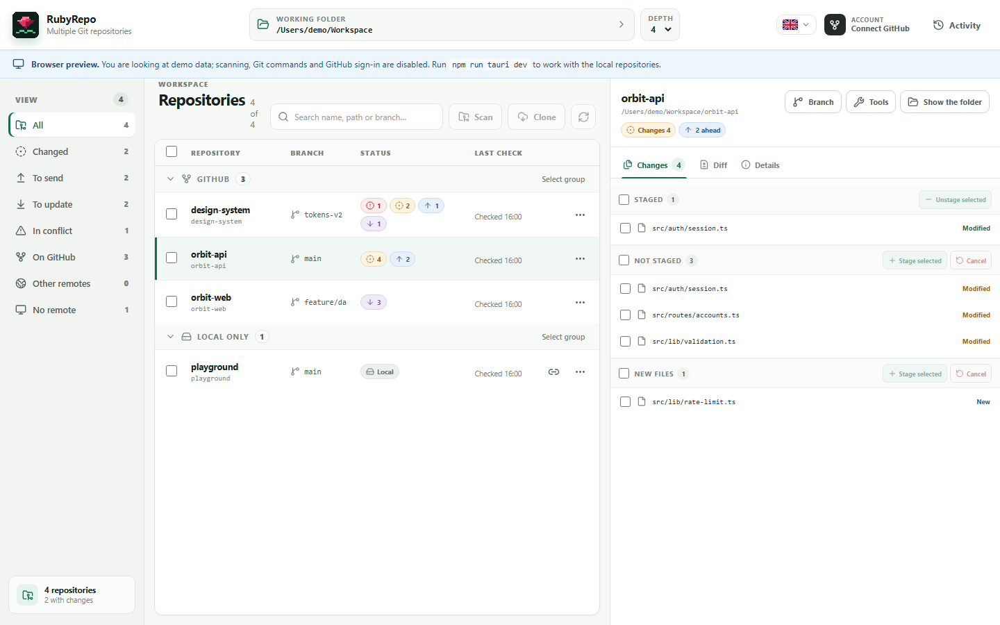

# RubyRepo

A cross-platform desktop app for inspecting and synchronising several local Git
repositories from one window. The frontend is React, TypeScript and Vite;
Tauri 2 connects the interface to a Rust backend that drives the Git client
already installed on the system.

The app speaks **English, Italian, French, Spanish and German**. English is the
original; the language is chosen from the flag in the top bar and every text
exists in all five.

> **Project status: 1.0, in real use.** The Git and GitHub backend is
> covered by tests; the interface far less so (see [Local
> verification](#local-verification)). Use it only on repositories whose content
> and configuration you know and trust: the app is not a sandbox for hostile
> repositories.

> **Platform testing:** RubyRepo 1.0.0 has only been launched and tested on
> Windows. The macOS and Linux builds are configured and checked by CI, but the
> app and its installers have never been run on either operating system. They
> may not work yet or may require platform-specific fixes.



*Browser preview with synthetic data; local Git and GitHub actions are disabled.*

## What it does

**Workspace**

- pick a working folder through a native dialog, with a configurable scan depth;
- recursive scan of the repositories it contains, with progress while it walks;
- a summary of branch, upstream, ahead/behind commits, and staged, modified, new
  or conflicted files;
- filters by state and by remote, with grouping into GitHub, other remotes and
  local only.

**Working on files**

- the detail of the changes, plus the staged and unstaged diff;
- selective stage and unstage, by single file or by group;
- discarding unstaged changes and deleting selected new files, behind a typed
  confirmation. Folders, special paths and nested repositories are refused.

**Git operations**

- a separate commit per repository, on what is already staged or explicitly
  including every change;
- batch fetch and push; pull with a choice of fast-forward, merge or rebase;
- switching and creating branches, including the ones that exist only on a
  remote;
- commit history, with a separate view of what a push would send;
- remotes: adding, changing the URL, removing;
- stashes: putting changes aside, reapplying, dropping;
- operations left half-way (merge, rebase, cherry-pick, revert): the state of
  the conflicted files, and aborting or continuing.

**GitHub**

- sign-in through the Device Flow, with no password and no client secret in the
  app;
- profile, installations, and the remote repositories the GitHub App can reach;
- cloning a GitHub repository into the workspace, choosing the folder and the
  name;
- creating a personal repository, public or private, empty or initialised with a
  README;
- deleting an administrable repository, behind typing its full name, and without
  touching the local folder;
- linking a local folder to a writable GitHub repository, running `git init` only
  when needed and checking the `origin` remote;
- authentication for HTTPS fetch and push through an ephemeral local askpass
  broker; the system keychain only serves to keep the session across restarts.

**Elsewhere**

- an activity log with the outcome of every repository;
- a browser preview with demonstration data, with no access to the filesystem or
  to Git.

## Architecture

```text
React + TypeScript + Vite
          │
          │ Tauri invoke / dialog / opener
          ▼
Rust backend (37 Tauri commands)
          │
          ├── walkdir: recursive scan
          ├── std::process::Command: Git processes, never through a shell
          ├── GitHub REST API: profile, installations, repositories
          ├── OS keychain: optional encrypted persistence of the GitHub session
          ├── local one-shot askpass broker: ephemeral delivery of the token
          └── in-memory state: repositories authorised by the scan or by an
              explicit link
                    │
             ┌──────┴────────┐
             ▼               ▼
      System Git      GitHub Device Flow
```

The backend looks for working directories containing a `.git` entry, then asks
each repository for its state with Git commands. Batch operations run
separately: one repository succeeding does not imply the others did, and there
is no global rollback.

The app implements no Git client of its own: it uses the `git` installed on the
system.

### How the text is translated

Every sentence the user can read lives in one dictionary,
`src/i18n/dictionary.ts`, with all five languages side by side. The type is
`satisfies Record<string, Entry>`, so **a missing language is a compile error**
rather than a gap someone finds while using the app.

The backend has no dictionary — it does not know which language is active. Its
messages therefore travel as an **identifier plus separate parameters**, next to
an English sentence:

```rust
AppError::translated("notFound", "scan.rootNotFolder", "The path is not a folder: …")
    .with("path", root.display().to_string())
```

The frontend translates when it recognises the identifier and shows the English
sentence when it does not, so a message never disappears. The parameters stay
separate from the sentence on purpose: it is the translation that decides where
a path or a count belongs, not the word order of the original.

Two kinds of text are deliberately not translated, and both are correct as they
are: **Git's own output**, which is Git speaking rather than the application,
and **messages from the operating system**, which arrive in the language of the
system.

## GitHub access

The official build uses a single public GitHub App and the public Client ID
embedded in the app. Each user authorises their own account once through
`https://github.com/login/device`, then installs the GitHub App on all their
repositories or only on the ones they want. The resulting token can reach only
the resources allowed to both the user and the GitHub App installation.

Required GitHub App permissions:

- `Metadata: Read-only`;
- `Contents: Read and write` for fetch and push;
- `Administration: Read and write` to create or delete repositories from the app;
- `Workflows: Read and write` only if files under `.github/workflows` need
  changing.

The `Administration` permission is broad: the build uses it exclusively for the
explicit create and delete operations, but GitHub will show the whole permission
during approval. If you would rather not grant it, the interface can open
`https://github.com/new` in the browser.

The Device Flow and token refresh need no client secret in a desktop app. If the
secure keychain is unavailable the session stays in memory only, and GitHub
fetch and push keep working until the app closes; on the next start you sign in
again. Signing out deletes the local credentials; revoking the authorisation on
the server side has to be done from the GitHub settings.

## Prerequisites

- **Git** on the `PATH`. A recent version supporting `git status --porcelain=v2`
  is recommended. `RUBYREPO_GIT_PATH` can point at the executable
  instead;
- **Node.js 22.22.2 LTS** recommended (the version pinned in `.nvmrc`).
  Node.js 24.15 or 26 and newer are also supported;
- **npm**, shipped with Node.js;
- **Rust stable** with Cargo and `rustfmt`, preferably through
  [rustup](https://rustup.rs/);
- the native dependencies [Tauri 2](https://v2.tauri.app/start/prerequisites/)
  requires.

The Tauri CLI is already a dev dependency: there is no need to install it
globally.

### Windows

- Microsoft C++ Build Tools with the **Desktop development with C++** workload;
- Microsoft Edge WebView2 Runtime, already present on modern Windows;
- the Rust MSVC toolchain — see [The MSVC toolchain on
  Windows](#the-msvc-toolchain-on-windows), it is not optional;
- the optional VBSCRIPT feature enabled if you want to produce the MSI package.

### macOS

```sh
xcode-select --install
```

Publishing `.app` and `.dmg` normally requires Apple signing and notarisation;
neither is configured in this repository.

### Linux (Debian/Ubuntu)

```sh
sudo apt update
sudo apt install -y \
  libwebkit2gtk-4.1-dev \
  build-essential \
  curl \
  wget \
  file \
  libxdo-dev \
  libssl-dev \
  libayatana-appindicator3-dev \
  librsvg2-dev
```

For other distributions use the official [Tauri
prerequisites](https://v2.tauri.app/start/prerequisites/).

To keep the GitHub sign-in across restarts the desktop session also needs a
Secret Service over D-Bus (GNOME Keyring or KDE Wallet, for instance). Without
one the token is not written in the clear: it stays in memory until the app
closes.

## Installing and running

```sh
npm ci
npm run tauri dev
```

To work on the frontend alone:

```sh
npm run dev
```

In an ordinary browser you get demonstration data. Scanning, diffs and Git
operations are available only in the Tauri window.

## Local verification

The whole pipeline in one command:

```sh
npm run verify
```

It runs, stopping at the first failure: frontend lint, three consistency checks,
frontend tests with coverage, the build (`tsc` included), `cargo fmt --check`,
`cargo check`, `cargo clippy -D warnings`, and the Rust tests.

### The three checks

Each was born from a real defect that the tests could not see, and each turns
that defect into a verification error instead of something a user discovers.

| Command | What it refuses | Why it exists |
| --- | --- | --- |
| `npm run check:css` | a class used in a component and absent from `App.css` | three dialogs shipped with no styling at all: they used `dialog-*` while the convention is `modal-*`. `getByRole` finds an unstyled button exactly as it finds a correct one, so every test stayed green |
| `npm run check:messages` | an identifier named by the backend with no dictionary entry, or an entry nobody uses | in the frontend `MessageId` is `keyof typeof messages`, so a typo does not compile. In the backend an identifier is just a string: getting it wrong makes nothing fail — the message degrades to English for all five languages |
| `npm run check:text` | a text the user can read that does not go through `t()` | searching for "what Italian looks like" failed four times: quoted strings miss the ones in backtick templates, accented characters miss "Deselect", and `>text<` on one line misses text on a line of its own. This one enumerates what reaches the screen instead of guessing, and asks for every exception to be declared with a reason |

### The pre-commit hook

```sh
sh scripts/install-hooks.sh
```

Run it once after cloning, because hooks live in `.git/hooks` and are not
versioned. It is knowingly bypassed with `git commit --no-verify`.

### Coverage

```sh
npm run test:coverage
```

The frontend suite has **84 tests** and covers around **39%** of statements and
**40%** of lines. It includes the pure functions (`repositoryUtils`), the IPC
boundary (`api.ts`), application-level locale ordering and the most sensitive
dialogs. The thresholds photograph today's number and stop it from falling;
they are raised when it rises, never lowered when it drops.

The Rust side has **96 tests**, including the Device Flow against a fake HTTP
server, but its coverage is not measured.

### The MSVC toolchain on Windows

On Windows the project **requires** the MSVC ABI. With GNU it compiles, but what
comes out does not work, in two ways that are both silent:

- the test executable does not start at all (`STATUS_ENTRYPOINT_NOT_FOUND`),
  because `tauri-build` injects the Common-Controls 6 manifest only into `bin`
  targets;
- the package builds with no error but the installed app dies on startup:
  `webview2-com-sys` links the WebView2 loader statically only under MSVC, and
  otherwise expects `WebView2Loader.dll` next to the executable — which the
  bundler does not include.

The second is the nastier one, because it produces an installer that looks fine
and cannot be distributed.

The constraint cannot live in `rust-toolchain.toml`, which accepts a single
channel: a Windows triple in there would make the project uncompilable
elsewhere. That is why `npm run test:rust` and `npm run tauri` go through
`scripts/windows-msvc.mjs`, which imposes the toolchain on Windows and stops if
it is missing. Install it once with:

```sh
rustup toolchain install stable-x86_64-pc-windows-msvc
```

## Desktop build

The build has to run natively on the target operating system:

```sh
npm run tauri build
```

The artefacts appear under `src-tauri/target/release/bundle/`. To limit which
bundles are produced:

```sh
# Windows, run on Windows
npm run tauri build -- --bundles msi,nsis

# macOS, run on macOS
npm run tauri build -- --bundles app,dmg

# Linux, run on Linux
npm run tauri build -- --bundles deb,rpm,appimage
```

On Windows two installers are produced with different installation modes, and
the difference matters:

- **NSIS** (`*-setup.exe`) installs per user into `%LOCALAPPDATA%` and **needs no
  administrator privileges**. This is the one to hand to someone who is not an
  administrator of their own machine.
- **MSI** (`*.msi`) installs per machine into `Program Files` and **requires
  administrator privileges**: without them it fails with error 1925.

The packages produced this way are not signed. Distributing them requires
configuring signing, notarisation and certificates per platform; see the [Tauri
distribution guide](https://v2.tauri.app/distribute/).

## Using it safely

- **Select only folders you trust.** Git configuration, hooks, filters,
  credential helpers and signing programs present in a repository can run local
  code.
- **Check the diff before committing.** *Include every change* runs `git add -A`
  and takes in modified, deleted and new files that Git does not ignore.
- **Stage** and **Unstage** use literal pathspecs and are limited to the files
  present in the current Git state. Unstage touches the index only and keeps the
  working tree.
- **Discard changes is destructive**: it restores tracked files from the staged
  version and deletes only the selected new files. Folders, special paths and
  nested repositories are refused, and the interface asks for a typed
  confirmation.
- **Pull** runs an authenticated fetch followed by a local merge. Fast-forward is
  the default and the only strategy that cannot produce an unexpected conflict;
  merge and rebase are available on request. It is refused if the working tree is
  dirty.
- **Push never force-pushes** and is refused if the remote branch is ahead. For a
  local branch with no upstream, the confirmation shows the intended destination
  and the first push sets the upstream with `--set-upstream`.
- **Credentials for non-GitHub remotes.** The app supplies credentials to GitHub
  only, through the GitHub App token. On every other remote — GitLab, Bitbucket,
  Azure DevOps, a company server — Git stays the system's own and keeps using
  the credential helper you already configured (on Windows, usually Git
  Credential Manager): the app does not see, ask for or keep those credentials.
  Only the terminal prompt stays disabled, because there is no terminal here and
  Git would wait until the deadline. For the same reason the system proxy keeps
  applying to those remotes, while it is excluded from authenticated operations
  towards GitHub.
- **When the GitHub App token is used**, the app starts an ephemeral askpass
  broker on localhost for each authenticated command. The Git process receives
  only the local endpoint and a random nonce; the token is delivered once, after
  the HTTPS prompt for `github.com` has been verified, and then the channel
  closes. Potentially sensitive Git traces are disabled and hooks are excluded
  from that process. Commits still honour the repository hooks. Push always uses
  `--no-verify`, including towards non-GitHub remotes: pre-push hooks do not run.
- The GitHub token is used only if every remote URL is HTTPS, without embedded
  credentials, on the standard port and with host exactly `github.com`. SSH and
  any other host use the system Git credentials.
- **Creating a remote repository** happens only after the explicit command in its
  summary; it configures no local remote and sends no files.
- **Deleting a remote repository** is offered only for repositories GitHub
  reports as administrable and requires typing `owner/repository` exactly. The
  backend rechecks the ID, the full name and the permission before the request.
  The app does not delete the local folder, does not remove the Git remote and
  offers no undo.
- **Linking** accepts only writable repositories returned by the current session
  and HTTPS URLs with host exactly `github.com`. If `origin` points elsewhere, or
  the folder belongs to a parent repository, the operation is refused. Linking
  creates no commit, downloads no history and pushes nothing.
- Git is started without a shell, with terminal prompts disabled and with the
  main environment variables that could change repository removed.
- HTTPS URLs shown in the interface hide any userinfo. Avoid tokens embedded in
  remote URLs regardless, because output and errors come from the Git client.
- The backend authorises in memory only the repositories returned by the latest
  scan or explicitly linked through the native dialog, and rechecks the paths
  before operating. The folders picked in the dialog survive a restart, in
  `chosen-folders.txt` inside the application folder; each entry is canonicalised
  again on re-reading, so a path that vanished or was tampered with does not get
  back in.

## Diagnostics

The app writes a rotating log file (2 MB, last 3 files kept) into the system log
folder:

| System | Path |
| --- | --- |
| Windows | `%LOCALAPPDATA%\com.rubyrepo.desktop\logs\` |
| macOS | `~/Library/Logs/com.rubyrepo.desktop/` |
| Linux | `$XDG_DATA_HOME/com.rubyrepo.desktop/logs/` or `~/.local/share/com.rubyrepo.desktop/logs/` |

In the same folder, `fatal.log` collects panics and startup failures. It is a
separate file because it has to be writable before the logger is initialised: in
release on Windows there is no console, so without it a failed start would leave
no trace at all.

The logs never contain the GitHub token, the body of API responses, or the
output of Git commands. When reporting a problem, attaching these two files is
the quickest way to understand what happened.

## Known limits

**Scanning**

- the backend default depth is 12, capped at 32; the interface offers 2 to 8;
- for speed the scan skips `node_modules`, `target`, `dist`, `.next`, `.cache`,
  `.gradle`, `.idea` and `.vscode`. Repositories inside those are not found;
- symbolic links are not followed, and unreadable directories produce warnings;
- bare repositories, with no working tree and no `.git` directory, are not
  detected;
- the scan stops at 2000 repositories and reports at most 100 warnings, stating
  how many it left out;
- scanning stays sequential; batches process up to 4 repositories at a time. They
  can be interrupted, they show progress, and every Git process has a deadline
  past which it is killed.

**Operations**

- staging works per file; staging individual lines or hunks is not available;
- Git LFS and recursive submodule handling have no dedicated support;
- file names that are not valid UTF-8 are shown with replacement characters and
  cannot be selected for stage or discard;
- a file selection is limited to 512 paths per operation;
- the diff returned to the interface is capped at roughly 350 KB in total, and
  the output of an operation at roughly 16 KB;
- the activity log in the interface does not persist across sessions; the
  diagnostic log file does.

**GitHub**

- the account integration supports one GitHub user at a time and `github.com`
  only; GitHub Enterprise Server is not configurable yet;
- creating a repository covers the connected personal account; creating one
  inside an organisation is not implemented;
- deleting an organisation repository can be refused by its policies even when
  the user holds the administrator role;
- linking a folder does not integrate an existing remote history. Fetch and push
  stay separate, and Git refuses a first push that is not fast-forward;
- ahead/behind state and the pre-flight check depend on the local remote
  references; run a fetch to refresh them.

**Distribution**

- the installers produced by the release pipeline are not signed: a Windows
  certificate and Apple notarisation are both missing;
- automatic updates are not configured: moving to a new version means
  downloading and running the new installer by hand. The updater depends on
  signing, so it comes after it.

**Translations**

- French, Spanish and German have no native reviewer. They are correct as a
  technical register, but a wrong nuance is something no test catches.

## Licence

Distributed under the terms of the **GNU General Public License v3.0 or later**.
The full text is in [LICENSE](LICENSE).

This program is distributed in the hope that it will be useful, but **WITHOUT
ANY WARRANTY**; without even the implied warranty of MERCHANTABILITY or FITNESS
FOR A PARTICULAR PURPOSE. See the GNU General Public License for more details.

Security reports follow the procedure described in
[SECURITY.md](SECURITY.md).
